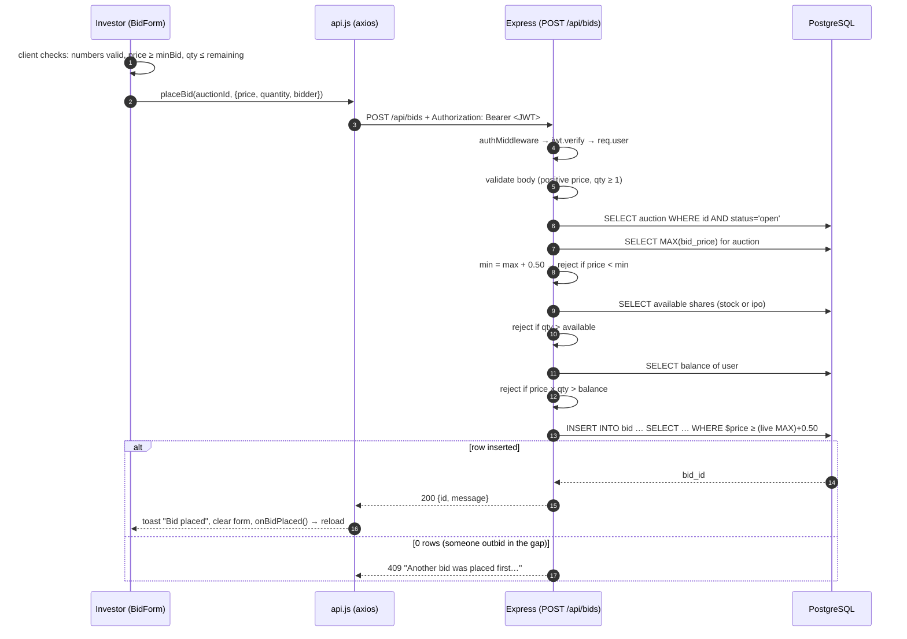
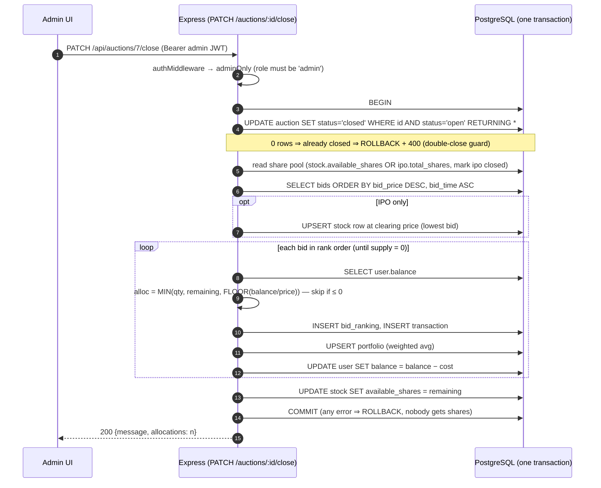
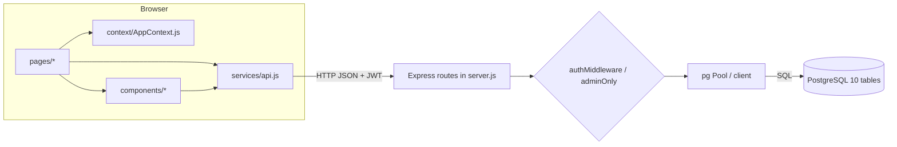

# 02 — Architecture

## 1. The big picture (3-tier)

```
┌────────────────────────────────────────────────────────────────────────────┐
│  BROWSER  ·  React 19 SPA (create-react-app)            http://localhost:3000│
│                                                                              │
│  index.js ─► App.js ─► <BrowserRouter>                                       │
│                         └► <AuthProvider>      (user, login, logout, JWT)    │
│                             └► <ToastProvider> (addToast)                    │
│                                 └► <AppRoutes> ─ Sidebar + <Routes>          │
│                                                                              │
│  pages/*  ──►  services/api.js (axios instance + dummy-mode switch)          │
│                  │  request interceptor : attach  Authorization: Bearer <JWT>│
│                  │  response interceptor: on 401 (non-/auth/) → logout+/login│
└──────────────────┼───────────────────────────────────────────────────────────┘
                   │  HTTP/JSON  (CORS: only ALLOWED_ORIGIN, default :3000)
┌──────────────────▼───────────────────────────────────────────────────────────┐
│  NODE.JS  ·  Express 4  ·  server.js (single file)        http://localhost:5000│
│                                                                              │
│  middleware:  cors → express.json(100kb) → [authMiddleware] → [adminOnly]    │
│  routes:      /api/auth  /api/auctions  /api/bids  /api/portfolio            │
│               /api/transactions  /api/watchlist                              │
│  data access: node-postgres Pool (max 10) · raw parameterised SQL · no ORM   │
│  security:    bcryptjs (cost 10) · jsonwebtoken (HS256, 24h)                 │
└──────────────────┬───────────────────────────────────────────────────────────┘
                   │  pg wire protocol  (port 5432)
┌──────────────────▼───────────────────────────────────────────────────────────┐
│  POSTGRESQL  ·  database `auction_system`                                    │
│  10 tables · 12 FKs (ON DELETE CASCADE) · CHECK/UNIQUE constraints · 9 indexes│
│  Multi-statement ACID transactions for: create auction, close auction        │
└──────────────────────────────────────────────────────────────────────────────┘
```

**Why 3-tier?** The browser is untrusted; every rule that matters (min bid, balance, role, state
transitions) is enforced on the server and/or in the database. The frontend repeats some checks only
for UX (e.g. `BidForm` checks the ₹0.50 increment) — never for safety.

## 2. Frontend architecture

```
src/
├── index.js                 mounts <App/> in React.StrictMode
├── App.js                   routing + route guards (SmartRoot, PrivateRoute, AdminRoute)
├── context/AppContext.js    AuthContext (user/login/logout/isAdmin) + ToastContext (addToast)
├── services/api.js          ALL network calls; axios instance; USE_DUMMY switch
├── data/dummyData.js        mock data for offline mode
├── utils/images.js          sector → Unsplash photo URL
├── components/              AuctionCard · BidForm · Timer · Sidebar · ConfirmDialog
└── pages/                   Landing · Login · Register · Home · Auctions · IPOPage
                             AuctionDetail · Portfolio · Transactions · Watchlist
                             Settings · AdminPanel
```

**Provider tree** (`App.js:83-93`): `BrowserRouter > AuthProvider > ToastProvider > AppRoutes`.
`ToastProvider` sits inside `AuthProvider` so any page can use both hooks.

**Route guards** (`App.js:25-49`)

| Guard | Behaviour |
|-------|-----------|
| `SmartRoot` at `/` | spinner while `loading`; `user ? <Home/> : <Landing/>` |
| `PrivateRoute` | not logged in → `<Navigate to="/" />` (the Landing page, *not* `/login`) |
| `AdminRoute` | not logged in or not admin → `<Navigate to="/" />` |

> Guards are **UX only**. A user can edit `localStorage` to *look* admin; the API still returns 403
> because `adminOnly` checks the role inside the signed JWT.

**State management:** no Redux. Local `useState` per page + two small contexts. Server data is
fetched in `useEffect` and held in component state; live pages re-fetch on a 3 s interval.

**Layout:** when logged in, `AppRoutes` renders `<div class="layout"> <Sidebar/> <div class="main-area"> <Routes/> </div></div>`; when logged out there is no sidebar (Landing/Login/Register are full-screen).

## 3. Backend architecture (`server.js`)

Everything lives in one file, in this order:

| Lines | Section |
|-------|---------|
| 1-16 | imports, `app`, CORS, JSON parser (100 kb limit), `PORT`, `JWT_SECRET` (+ warning if default) |
| 19-26 | `pg.Pool` (host/user/password/db/port from env, `max: 10`) |
| 29-45 | `authMiddleware`, `adminOnly` |
| 49-100 | Auth routes: register, login |
| 105-194 | Account routes: `GET/PATCH/DELETE /api/auth/me` |
| 198-482 | Auction routes: list, get, create, **close (allocation)**, open |
| 487-615 | Bid routes: all-bids (admin), bids by auction, **place bid** |
| 619-654 | Portfolio |
| 658-676 | Transactions |
| 680-717 | Watchlist (get / add / remove) |
| 721-723 | `app.listen` |

**Two connection styles, on purpose**

- `pool.query(...)` — one-shot statements (reads; single-statement writes).
- `const client = await pool.connect(); BEGIN … COMMIT/ROLLBACK; client.release()` — used **only** where
  several statements must succeed together: `POST /api/auctions` and `PATCH /api/auctions/:id/close`.
  A transaction must run on *one* connection, which is why these use a checked-out `client`, not `pool.query`.

## 4. Request lifecycle — placing a bid (end-to-end)



Note the **two-layer defence**: the JS pre-checks give friendly errors; the final guarded `INSERT`
is the authoritative, race-proof check (see [06](06-algorithms-and-why.md#3-atomic-guarded-bid-insert-toctou-fix)).

## 5. Request lifecycle — closing an auction (the important one)



## 6. Authentication & authorisation flow

```
REGISTER / LOGIN
  client ──POST {username,password}──► server
  server: SELECT user → bcrypt.compare → jwt.sign({user_id,name,email,username,role}, JWT_SECRET, 24h)
  server ──{user, token}──► client
  client: AuthContext.login(user, token)
          localStorage["user"]      = JSON(user)
          localStorage["authToken"] = token

EVERY LATER REQUEST
  axios request interceptor reads localStorage["authToken"] → header "Authorization: Bearer <token>"
  server authMiddleware: header.split(" ")[1] → jwt.verify → req.user = payload  (else 401)
  adminOnly: req.user.role !== 'admin' → 403

EXPIRY / INVALID
  server 401 → axios response interceptor:
      if status==401 AND url does NOT contain "/auth/":
          clear localStorage, window.location.href = "/login"
  (the "/auth/" exclusion lets a *wrong password* show an error instead of redirecting)

PAGE REFRESH
  AuthProvider useEffect reads localStorage["user"] → setUser → `loading` false
```

Facts worth knowing:
- The JWT **does not contain `balance`** — that's why Settings calls `GET /api/auth/me` for a live balance.
- The JWT payload embeds `name/email/username/role`, so `PATCH /api/auth/me` **re-issues a new token**.
- `role` lives in the token → a role change in the DB isn't reflected until the user logs in again (stateless-JWT trade-off).

## 7. Real-time model: polling

| Page | What is polled | Interval |
|------|----------------|----------|
| Home | `GET /auctions` | 3 s |
| Auctions | `GET /auctions` | 3 s |
| IPOPage | `GET /auctions?type=ipo` | 3 s |
| AuctionDetail | `GET /auctions/:id` + `GET /bids?auctionId=` (parallel) | 3 s |
| AdminPanel | `GET /auctions` + `GET /bids/all` (parallel) | 3 s |
| Portfolio / Transactions / Watchlist / Settings | once on mount | — |

Every polled page uses the same pattern:

```js
loadData();
let interval = setInterval(loadData, 3000);
const onVisibility = () => {
  if (document.hidden) clearInterval(interval);              // tab hidden → stop
  else { loadData(); interval = setInterval(loadData, 3000); } // tab visible → refresh now + resume
};
document.addEventListener("visibilitychange", onVisibility);
return () => { clearInterval(interval); document.removeEventListener("visibilitychange", onVisibility); };
```

The cleanup function prevents leaked timers/listeners on unmount.

## 8. The auction state machine

```
          admin: PATCH /open                admin: PATCH /close
UPCOMING ───────────────────────►  OPEN  ───────────────────────►  CLOSED
 (created)   UPDATE … WHERE            (bids accepted)   BEGIN; UPDATE … WHERE status='open';
             status='upcoming'                           allocate; COMMIT
```

- Each transition is a **conditional `UPDATE … WHERE status = '<previous>'`**: if the row isn't in the right state, zero rows change and the API returns 400. The state machine is enforced *inside the SQL*, so it is also race-safe.
- **There is no automatic transition.** `end_time` is only informational + drives the countdown. After it passes, an auction stays `open` ("Awaiting close" in the UI) until an admin clicks Close. (Consequence: the server still accepts bids after `end_time` — ✅ verified; see doc 11.)
- `ipo.status` is set to `'closed'` on close but **never set to `'open'`** — the `auction.status` is the source of truth the UI uses. ✅ verified: after opening auction 6, `auction.status='open'` while `ipo.status` stayed `'upcoming'`.

## 9. Concurrency & transaction model

| Concern | Mechanism | Where |
|---------|-----------|-------|
| Two bids at the same price at the same instant | Single `INSERT … SELECT … WHERE $price >= COALESCE((SELECT MAX…), base) + 0.50` re-checks the live max inside the insert | `server.js:600-606` |
| Admin double-clicks Close / two admins | `UPDATE auction SET status='closed' WHERE … AND status='open' RETURNING *` — second caller gets 0 rows | `server.js:376-383` |
| Partial failure during allocation | `BEGIN … COMMIT` on a dedicated `client`; `catch → ROLLBACK`; `finally → client.release()` | `server.js:370-467` |
| Orphan company/stock rows if auction insert fails | `BEGIN … COMMIT` around company+stock/ipo+auction | `server.js:320-366` |
| Duplicate company / stock | `ON CONFLICT (ticker)` / `ON CONFLICT (company_id)` upserts | `server.js:325-330, 341-349` |
| Duplicate portfolio / watchlist rows | `UNIQUE(user_id, stock_id)` + `ON CONFLICT` / catch `23505` | schema + `server.js:441-447, 703` |

Isolation level is Postgres' default **READ COMMITTED** (no explicit `SET TRANSACTION`). Honest gap:
the *bid pre-checks* (balance, available quantity) are separate statements from the final insert, so
between them state can change; the final insert only re-checks the **price**. The balance is re-checked
authoritatively at **allocation** time, which is why the affordability cap exists. (See "no escrow" in doc 11.)

## 10. Deployment / configuration

| Variable | Default | Used by |
|----------|---------|---------|
| `PORT` | 5000 | backend listen port |
| `DB_HOST` / `DB_USER` / `DB_PASSWORD` / `DB_NAME` / `DB_PORT` | localhost / postgres / postgres / auction_system / 5432 | `pg.Pool` |
| `JWT_SECRET` | `"auction_secret"` (⚠ insecure fallback, warns at boot) | sign/verify tokens |
| `ALLOWED_ORIGIN` | `http://localhost:3000` | CORS |
| `REACT_APP_API_URL` | `http://localhost:5000/api` | frontend base URL |
| `REACT_APP_USE_DUMMY` | unset | `"true"` → mock data, no backend |

CRA bakes `REACT_APP_*` into the bundle **at build/start time**, so changing them needs a restart/rebuild.

## 11. Data-flow summary (who talks to whom)



For the file-by-file and function-by-function call map see [09-call-map.md](09-call-map.md).
