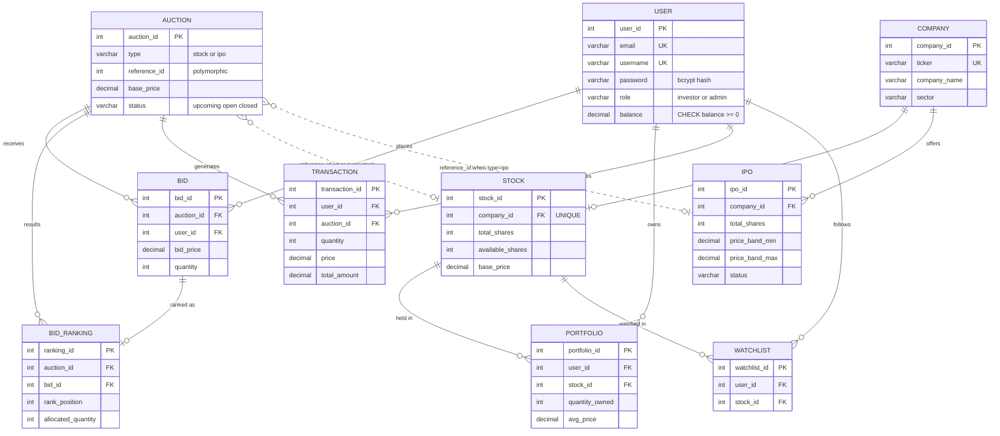

# 05 — Database, Data Modelling, "Features" & the Dataset

## 0. Read this before the interview: what "dataset / modelling / feature engineering" mean *here*

This project has **no machine-learning model, no training data, no feature-engineering pipeline**.
When an interviewer says *"how did you model the dataset?"* or *"what feature engineering did you do?"*
about **this** project, the truthful and still-impressive mapping is:

| Question wording | What it maps to in this project |
|------------------|----------------------------------|
| "The dataset" | The **PostgreSQL database** and its **seed data** in `schema.sql` (synthetic: 4 users, 6 companies, 6 auctions, 15 bids…). Live data is whatever users create at runtime. There is no external dataset. |
| "Modelling" | **Relational data modelling**: entities → ER diagram → 10 tables → keys, constraints, normalisation, indexes (sections 1-5 below). |
| "Feature engineering" | **Derived / computed attributes** — values computed from raw rows (highest bid, subscription %, weighted-average cost, P&L, clearing price …). Section 6 lists every one: formula, where it's computed (SQL / server JS / browser) and why. |
| "Which algorithm?" | The **allocation algorithm** (greedy price-time priority) — doc [06](06-algorithms-and-why.md). |

**If directly asked "did you use ML?"** say:

> "No — this was a DBMS-focused project, so the 'modelling' was relational: I designed the ER model and
> a 3NF-style schema, and the 'features' are derived fields such as current highest bid, subscription
> percentage and weighted-average cost basis. If I extended it with ML I'd look at shill-bid / anomaly
> detection or clearing-price forecasting — but that's future scope, not something I built."

(Section 8 sketches those extensions honestly, flagged as hypothetical.)

---

## 1. Entity-Relationship model



(The repo also has `er-diagram.html` — the same ER in Mermaid, dark theme — and `er_diagram_chen_1779436391514.png`, a Chen-notation export.)

### Cardinalities in words

| Relationship | Cardinality | Enforced by |
|--------------|-------------|-------------|
| company → stock | 1 : 0..1 | `stock.company_id UNIQUE` |
| company → ipo | 1 : N (successive IPOs possible) | FK only |
| user → bid / portfolio / transaction / watchlist | 1 : N each | FKs |
| auction → bid / bid_ranking / transaction | 1 : N each | FKs |
| bid → bid_ranking | intended 1 : 0..1 | **FK only — no UNIQUE(bid_id)**; the app writes at most one |
| user ↔ stock (holdings) | M : N via `portfolio` (+ attributes `quantity_owned`, `avg_price`) | `UNIQUE(user_id, stock_id)` |
| user ↔ stock (interest) | M : N via `watchlist` | `UNIQUE(user_id, stock_id)` |
| auction → stock \| ipo | N : 1 *polymorphic* | **app code only** (`type` + `reference_id`) |

`portfolio` and `watchlist` are **associative (junction) entities** resolving M:N. `portfolio` carries
descriptive attributes of the relationship (quantity, average price) — a good example to cite.

---

## 2. The 10 tables — what, why, key constraints

| # | Table | Purpose | Notable design choices |
|---|-------|---------|------------------------|
| 1 | `"user"` | Accounts for investors **and** admins; holds cash `balance` | Quoted because `user` is a reserved word. `role CHECK IN ('investor','admin')`; `balance DECIMAL(15,2) DEFAULT 1000000 CHECK (balance >= 0)` — the DB itself can never let a balance go negative. `email`, `username` `UNIQUE`. Password column holds the bcrypt hash only. |
| 2 | `company` | Master catalogue of listed entities | `ticker UNIQUE`; `logo_letter CHAR(1)` is a derived UI convenience (first letter). Never referenced directly by auction/bid/portfolio — always through stock/ipo. |
| 3 | `stock` | Share inventory of an already-listed company | `company_id UNIQUE` ⇒ **one stock row per company**. `available_shares CHECK >= 0`, `total_shares CHECK > 0`, `base_price CHECK > 0`. |
| 4 | `ipo` | An IPO offering window with a price band | `price_band_min/max`, `start_date/end_date`, `status`. A company may have several IPO rows over time (no UNIQUE). |
| 5 | `auction` | The auction event + its state machine | **Polymorphic** `reference_id` (stock_id *or* ipo_id) disambiguated by `type`. `status IN ('open','closed','upcoming')`. `base_price` is the opening price. |
| 6 | `bid` | Every individual bid | `bid_price > 0`, `quantity > 0`. Treated as **immutable** — no UPDATE/DELETE path in the app. |
| 7 | `bid_ranking` | Allocation result per bid | Written **only** at close, only for bids that won ≥ 1 share. `rank_position`, `allocated_quantity >= 0`. |
| 8 | `portfolio` | Holdings ledger | `UNIQUE(user_id, stock_id)` → one row per (investor, stock); upserted with weighted-average cost. |
| 9 | `"transaction"` | Immutable receipts/audit log | One row per allocated bid; stores the price actually paid and `total_amount = quantity × price`. Never updated by the app. |
| 10 | `watchlist` | User-follows-stock junction | `UNIQUE(user_id, stock_id)` makes duplicate adds impossible at the DB level. |

### Foreign keys (all 12 use `ON DELETE CASCADE`)

```
stock.company_id        → company          ipo.company_id        → company
bid.auction_id          → auction          bid.user_id           → "user"
bid_ranking.auction_id  → auction          bid_ranking.bid_id    → bid
portfolio.user_id       → "user"           portfolio.stock_id    → stock
"transaction".user_id   → "user"           "transaction".auction_id → auction
watchlist.user_id       → "user"           watchlist.stock_id    → stock
```

✅ **Verified cascade:** deleting user `amit` removed his 4 bids, 2 portfolio rows, 2 transactions and the
2 `bid_ranking` rows hanging off his bids (cascade through `bid`). **Not** reversed: `stock.available_shares`
for the shares he'd won stayed decremented. This is why a real system would soft-delete users to keep the audit ledger.

### Check constraints (guard-rails the database enforces by itself)

`balance >= 0` · `total_shares > 0` · `available_shares >= 0` · `base_price > 0` · `bid_price > 0` ·
`quantity > 0` · `allocated_quantity >= 0` · `quantity_owned >= 0` · `avg_price >= 0` ·
`total_amount > 0` · `role IN (…)` · `status IN (…)` · `type IN ('stock','ipo')`.

Interview line: *"Application checks give nice messages, but the CHECK/UNIQUE/FK constraints mean that even
a bug in my JavaScript can't corrupt the data."*

### Data types — why

| Choice | Reason |
|--------|--------|
| `DECIMAL(12,2)` / `(15,2)` for money | Exact decimal arithmetic. `FLOAT` would accumulate rounding error (0.1 + 0.2 problem). |
| `INT` for share counts | Whole shares; max ≈ 2.1 billion is ample here |
| `TIMESTAMPTZ` | Time-zone-aware instants — auctions span users/time zones |
| `SERIAL` surrogate PKs | Simple, stable; natural keys (ticker, email) can change |
| `VARCHAR` + `CHECK IN (…)` instead of an `ENUM` | Easier to alter than a Postgres ENUM type |

> pg returns `DECIMAL` as **strings** to JavaScript (to avoid precision loss) — that's why the server
> wraps values in `parseFloat(...)` and the frontend does `parseFloat(t.total_amount)`.

---

## 3. Normalisation — honest analysis

| Form | Verdict | Evidence |
|------|---------|----------|
| **1NF** | ✅ | All columns atomic; each bid/allocation is its own row; no arrays or repeating groups |
| **2NF** | ✅ | Every table has a single-column surrogate PK, so no partial dependencies. `portfolio`/`watchlist` use `UNIQUE(user_id, stock_id)` as a business key |
| **3NF** | ✅ *mostly* — a few **deliberate denormalisations** | below |

**Deliberate / known denormalisations (say these before they're found):**

| Redundancy | Why it exists | Risk |
|------------|---------------|------|
| `transaction.total_amount` = `quantity × price` | Audit rows must record what was charged *at that moment*; also avoids recompute | Could drift if someone edits rows (app never does) |
| `portfolio.avg_price` is derived from past transactions | Cheap O(1) read; weighted-average maintained incrementally at allocation | Must be maintained in the same transaction (it is) |
| `stock.available_shares` could be `total_shares − Σ allocated` | Fast read + the thing bids are checked against | Maintained transactionally; **but** re-creating a stock auction resets it (`ON CONFLICT … DO UPDATE SET available_shares = EXCLUDED…`) |
| `ipo.status` duplicates `auction.status` | Meant for IPO-page display | ✅ **verified stale**: set `closed` on close but never `open` — UI uses `auction.status` |
| `auction.base_price` vs `ipo.price_band_min` | Auction keeps its own opening price | Two sources of truth for IPO price |
| `company.logo_letter` derived from `company_name` | Frontend avatar convenience | Trivial |
| `auction.reference_id` polymorphic | One auction table serves both stock and IPO auctions → simpler list query | **No referential integrity at DB level** (can point at a non-existent id) |

**Better designs for the polymorphic link (if asked "how would you fix it?"):**
1. Two nullable FK columns `stock_id`, `ipo_id` on `auction` + `CHECK ((stock_id IS NOT NULL) <> (ipo_id IS NOT NULL))` → real FKs, still one table.
2. A supertype table `instrument(instrument_id, kind)` with `stock` and `ipo` as subtypes sharing the PK.
3. Separate `stock_auction` and `ipo_auction` tables (fully normalised; duplicates the list query via `UNION`).

**Why both `bid_ranking` and `transaction`?** They answer different questions. `bid_ranking` is the
*auction-centric result* (rank + allocated qty per bid — drives admin/ranking views). `transaction` is the
*user-centric financial receipt* (price paid, total, timestamp). They overlap in data but have different
consumers and lifecycles; a leaner schema could derive one from the other.

---

## 4. Indexes

| Index | Serves |
|-------|--------|
| `idx_bid_auction (bid.auction_id)` | bid book, MAX/COUNT per auction (hottest path — polled every 3 s) |
| `idx_bid_user (bid.user_id)` | a user's bids |
| `idx_auction_status`, `idx_auction_type` | list filters `?status=` / `?type=` |
| `idx_portfolio_user`, `idx_transaction_user`, `idx_watchlist_user` | per-user pages |
| `idx_transaction_auction`, `idx_bid_ranking_auction` | allocation lookups per auction |

Also implicit indexes from every PK and every `UNIQUE` (`email`, `username`, `ticker`, `stock.company_id`,
`(user_id, stock_id)` ×2).

**Gaps worth knowing:** a composite `bid(auction_id, bid_price DESC)` would turn `MAX(bid_price)` and the
"top bid" subquery into index-only lookups; there's no index on `bid_ranking(bid_id)` (the FK column) or on
`auction(type, reference_id)` (used in every polymorphic join). Low-cardinality indexes on `status`/`type`
help little with 6 rows — they're there for the *principle* and for growth.

---

## 5. How tables connect — the polymorphic join (the trickiest query)

```sql
FROM auction a
LEFT JOIN stock   s ON a.type = 'stock' AND a.reference_id = s.stock_id
LEFT JOIN ipo     i ON a.type = 'ipo'   AND a.reference_id = i.ipo_id
LEFT JOIN company c ON (a.type = 'stock' AND s.company_id = c.company_id)
                    OR (a.type = 'ipo'   AND i.company_id = c.company_id)
```

Both sides are `LEFT JOIN`ed and the `type` discriminator in the `ON` clause makes only the correct one
match; `CASE WHEN a.type='stock' THEN s.total_shares WHEN a.type='ipo' THEN i.total_shares END` then picks
the right column. (`server.js:198-251`, `253-297`.)

**IPO → Stock promotion.** An IPO company has no `stock` row until its auction closes. On close, the server
`INSERT … ON CONFLICT (company_id) DO UPDATE SET base_price = …` creates it at the **clearing price** with
`available_shares = 0` initially, then the final `UPDATE stock SET available_shares = remaining` writes back
unsold IPO shares. ✅ verified (QPFL: `base_price 645`, `total_shares 1,000,000`, `available 994,329`).

---

## 6. "Feature engineering" — every derived value in the project

### 6a. Computed in SQL (server-side)

| Derived field | Formula / SQL | Where | Why |
|---------------|---------------|-------|-----|
| `current_highest_bid` | `(SELECT MAX(bid_price) FROM bid WHERE auction_id=…)`; if no bids → `base_price` | `GET /auctions`, `/:id` | Live price without storing it (single source of truth = the bids) |
| `highest_bidder` | `SELECT username … ORDER BY bid_price DESC LIMIT 1` | same | Leader display |
| `bid_count` | `(SELECT COUNT(*) FROM bid …)` | `GET /auctions` | Activity metric |
| `total_shares` | `CASE type WHEN 'stock' THEN s.total_shares WHEN 'ipo' THEN i.total_shares END` | same | Polymorphic pick |
| `remaining_shares` | stock → `s.available_shares`; ipo → `i.total_shares − COALESCE(SUM(bid_ranking.allocated_quantity),0)` | same | How much is left |
| `price_band_min/max` | only for `type='ipo'` | same | IPO price-band UI |
| `won_at` | `MIN(transaction.transaction_date)` through a polymorphic subquery | `GET /portfolio` | "Acquired on" date |
| Clearing price | `bidsResult.rows[last].bid_price` (the **lowest** bid), else `base_price` if no bids | `PATCH /close` | New stock's `base_price` |
| Allocated quantity | `MIN(bid.quantity, remaining, ⌊balance / bid_price⌋)` | `PATCH /close` | Supply + affordability cap |
| Weighted-average cost | `(old_avg·old_qty + new_price·new_qty) / (old_qty + new_qty)` | `PATCH /close` (portfolio upsert) | Blended cost basis |
| Default IPO price band | `min = basePrice`, `max = basePrice × 1.2` when not supplied (the Admin form never supplies them, so it's **always** this default) | `POST /auctions` | Sensible band without extra input |
| Ticker / logo | `ticker.toUpperCase()`, `company[0].toUpperCase()` | `POST /auctions` | Normalise input |

### 6b. Computed in server JavaScript

| Field | Formula | Where |
|-------|---------|-------|
| `totalInvestment` | `quantity_owned × avg_price` | `GET /portfolio` |
| `currentPrice` | `base_price × 1.05` (**simulated**) | `GET /portfolio` |
| bid `status` | index 0 in `ORDER BY bid_price DESC` ⇒ `"highest"`, rest `"outbid"` (so a closed auction still labels its top bid "highest") | `GET /bids`, `/bids/all` |
| `minBid` | `max + 0.50`, rounded to 2 dp | `POST /bids` |

### 6c. Computed in the browser

| Metric | Formula | File |
|--------|---------|------|
| Change vs base % | `(highestBid − basePrice) / basePrice × 100` | AuctionCard, AuctionDetail, Home, AdminPanel, IPOPage |
| Subscription / fill % | `(totalShares − remainingShares) / totalShares × 100` | AuctionCard, AuctionDetail, IPOPage |
| Total investment preview | `price × quantity` | BidForm |
| Quick-fill prices | `minBid`, `highest × 1.01`, `highest × 1.05` | BidForm |
| Depth bar | `bid.price / maxBidPrice × 100` | AuctionDetail |
| Time remaining | `max(0, ⌊(endTime − now)/1000⌋)`; urgent < 600 s, critical < 60 s | Timer |
| Portfolio: value, P&L, P&L %, allocation % | `currentPrice × qty`; `value − invested`; `gain/invested × 100`; `value/totalValue × 100` | Portfolio |
| Platform volume | `Σ highestBid × (totalShares − remainingShares)` ÷ 1e7 → "Cr" | Home, AdminPanel |
| Avg bid price, highest single bid, most active | mean / max / argmax(bidCount) over auctions | Home |
| Market pulse % | `count(status) / count(all)` | Home |
| IPO price-band marker | `clamp((highest − min) / (max − min), 0, 100)%` | IPOPage |
| Total invested / unique companies | `Σ total_amount`; `new Set(tickers).size` | Transactions |
| Masked bidder | `name[0] + "*"×(≤3)` (cosmetic only — API returns real usernames ✅ verified) | AuctionDetail |

---

## 7. The seed dataset (`schema.sql`)

Synthetic, hand-written, INR prices. **Timestamps are relative to load time** (`NOW() − INTERVAL …`).

| Table | Rows | Notes |
|-------|------|-------|
| user | 4 | admin ₹50L, rajesh ₹15L, priya ₹20L, amit ₹12L (bcrypt hashes) |
| company | 6 | NovaTech (IT), GreenFuel (Clean Energy), QuantumPay (Fintech), MedGenix (Pharma), SpaceLogix (Infra), CyberShield (Cybersecurity) |
| stock | 4 | NovaTech, GreenFuel, SpaceLogix, MedGenix (created as if its IPO closed at ₹2,600) |
| ipo | 3 | QuantumPay (open, band 550–750), MedGenix (closed, 2200–2700), CyberShield (upcoming, 1200–1450) |
| auction | 6 | #1 NovaTech stock open · #2 GreenFuel stock open · #3 QuantumPay IPO open · #4 MedGenix IPO closed · #5 SpaceLogix stock open · #6 CyberShield IPO upcoming |
| bid | 15 | auction 1: 5, auction 2: 3, auction 3: 3, auction 4: 2, auction 5: 2 |
| bid_ranking / portfolio / transaction | 2 / 2 / 2 | the closed MedGenix IPO: amit 500 @ 2678, rajesh 200 @ 2600 |
| watchlist | 5 | (rajesh: stocks 1,2), (priya: 1,3), (amit: 2) |

Things to know about the seed: it is inserted by raw SQL, so it **bypasses API validation** and the close
logic — user balances are *not* debited for the pre-closed MedGenix wins, and Priya's bid on QuantumPay
(₹712.50 × 5000 ≈ ₹35.6 L) exceeds her ₹20 L balance. That is realistic data for demonstrating the
affordability cap at close.

---

## 8. If asked about ML anyway — honest, clearly-hypothetical extensions

*(None of this is implemented. Present it as "what I'd explore", not "what I did".)*

| Idea | Possible features (would be *engineered from the `bid` table*) | Caveat |
|------|---------------------------------------------------------------|--------|
| **Shill-bid / anomaly detection** | bids per bidder per minute, increment size distribution, time-to-close of each bid, price jump vs previous top, bidder history | Needs labelled/simulated data; with ₹0.50 minimum increments a "sniper" or "ramp" pattern is detectable |
| **Clearing-price forecasting** | subscription ratio, position inside price band, bid-count growth rate, time remaining | The seed (15 bids) is far too small — you'd simulate auctions; use **time-based** train/test split, not random |
| **Watchlist recommendations** | sector co-occurrence across users' watchlists | Needs many users |

Good framing: *"The relational schema already stores exactly the event stream (bid, bid_time, price,
quantity) these models need, which was a side-benefit of keeping bids immutable."*
