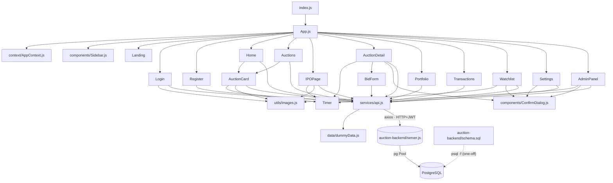

# 09 — Call Map: who calls whom, and what comes out

Built from the real `import` statements and handlers (not from the README). Use it to answer
*"walk me through what happens when a user does X"* and *"which files depend on Y?"*

Contents: [1 File graph](#1-file-dependency-graph) · [2 Reverse index](#2-reverse-index-who-uses-what) ·
[3 Page → API](#3-page--api-calls) · [4 UI action → SQL](#4-ui-action--api--handler--sql) ·
[5 Endpoint × table matrix](#5-endpoint--table-matrix-r--w) · [6 Backend internal call trees](#6-backend-internal-call-trees) ·
[7 Component trees](#7-component-trees)

---

## 1. File dependency graph



### Imports per file (frontend)

| File | Imports from the project |
|------|--------------------------|
| `index.js` | `App`, `reportWebVitals`, `index.css` |
| `App.js` | `AppContext` (AuthProvider, ToastProvider, useAuth), `Sidebar`, all 12 pages |
| `context/AppContext.js` | – (React only) |
| `services/api.js` | `data/dummyData` (+ dynamic import of `DUMMY_USERS` in `loginUser`) |
| `components/AuctionCard.js` | `Timer`, `utils/images`, `api` (`addToWatchlist`, `removeFromWatchlist`), `AppContext` (`useToast`) |
| `components/BidForm.js` | `AppContext` (`useToast`), `api` (`placeBid`) |
| `components/Timer.js` | – |
| `components/Sidebar.js` | `AppContext` (`useAuth`) |
| `components/ConfirmDialog.js` | – |
| `pages/Landing.js` | – (only `useNavigate`) |
| `pages/Login.js` | `AppContext` (`useAuth`,`useToast`), `api.loginUser`, `images.LOGIN_BG` |
| `pages/Register.js` | `AppContext`, `api.registerUser` |
| `pages/Home.js` | `api.fetchAuctions`, `AuctionCard` |
| `pages/Auctions.js` | `api.fetchAuctions`, `AuctionCard` |
| `pages/IPOPage.js` | `api.fetchAuctions`, `Timer`, `images.sectorImage` |
| `pages/AuctionDetail.js` | `api` (`fetchAuctionById`,`fetchBids`,`closeAuction`,`fetchWatchlist`,`addToWatchlist`,`removeFromWatchlist`), `AppContext`, `Timer`, `BidForm`, `ConfirmDialog` |
| `pages/Portfolio.js` | `api.fetchPortfolio`, `AppContext.useAuth` |
| `pages/Transactions.js` | `api.fetchTransactions` |
| `pages/Watchlist.js` | `api` (`fetchWatchlist`,`removeFromWatchlist`), `AppContext.useToast`, `images.sectorImage`, `ConfirmDialog` |
| `pages/Settings.js` | `AppContext`, `api` (`fetchMe`,`updateProfile`,`deleteAccount`), `ConfirmDialog` |
| `pages/AdminPanel.js` | `api` (`fetchAuctions`,`fetchAllBids`,`createAuction`,`closeAuction`,`openAuction`), `AppContext.useToast`, `Timer`, `ConfirmDialog` |

Backend: `server.js` requires `dotenv`, `express`, `cors`, `pg`, `bcryptjs`, `jsonwebtoken`. `schema.sql` is not imported — it's run once with `psql`.

---

## 2. Reverse index: who uses what

### `services/api.js` functions → callers

| API function | Called by |
|--------------|-----------|
| `fetchAuctions` | Home, Auctions, IPOPage (`{type:"ipo"}`), AdminPanel |
| `fetchAuctionById` | AuctionDetail |
| `createAuction` | AdminPanel |
| `openAuction` | AdminPanel |
| `closeAuction` | AdminPanel, AuctionDetail |
| `fetchBids` | AuctionDetail |
| `fetchAllBids` | AdminPanel |
| `placeBid` | BidForm |
| `fetchPortfolio` | Portfolio |
| `fetchTransactions` | Transactions |
| `fetchWatchlist` | AuctionDetail, Watchlist |
| `addToWatchlist` | AuctionCard, AuctionDetail |
| `removeFromWatchlist` | AuctionCard, AuctionDetail, Watchlist |
| `loginUser` | Login |
| `registerUser` | Register |
| `fetchMe`, `updateProfile`, `deleteAccount` | Settings |

### Shared pieces → users

| Piece | Used by |
|-------|---------|
| `useAuth` | App (guards), Sidebar, AuctionDetail, Portfolio, Login, Register, Settings |
| `useToast` | AuctionCard, BidForm, AuctionDetail, AdminPanel, Login, Register, Settings, Watchlist |
| `Timer` | AuctionCard, IPOPage, AuctionDetail, AdminPanel |
| `ConfirmDialog` | AuctionDetail, AdminPanel, Settings, Watchlist |
| `AuctionCard` | Home, Auctions |
| `BidForm` | AuctionDetail |
| `sectorImage` | AuctionCard, IPOPage, Watchlist |
| `Sidebar` | App |

---

## 3. Page → API calls

| Page | On mount | Polling | User actions |
|------|----------|---------|--------------|
| Landing | – | – | navigate to login/register |
| Login | – | – | `loginUser` |
| Register | – | – | `registerUser` |
| Home | `fetchAuctions` | 3 s | cards → watch ★ (`add/removeFromWatchlist`) |
| Auctions | `fetchAuctions` | 3 s | search/filter/sort (client-side), ★ |
| IPOPage | `fetchAuctions({type:"ipo"})` | 3 s | filter (client-side) |
| AuctionDetail | `fetchAuctionById` + `fetchBids`; `fetchWatchlist` (stock only) | 3 s (auction + bids) | `placeBid` (via BidForm), `closeAuction` (admin), watch toggle |
| Portfolio | `fetchPortfolio` | – | view toggle |
| Transactions | `fetchTransactions` | – | – |
| Watchlist | `fetchWatchlist` | – | `removeFromWatchlist` |
| Settings | `fetchMe` | – | `updateProfile` ×2 (profile / password), `deleteAccount` |
| AdminPanel | `fetchAuctions` + `fetchAllBids` | 3 s | `createAuction`, `openAuction`, `closeAuction` |

---

## 4. UI action → API → handler → SQL

| UI action | `api.js` fn | Endpoint | `server.js` handler | SQL statements (essence) | Output to UI |
|-----------|-------------|----------|---------------------|--------------------------|--------------|
| Register | `registerUser` | `POST /auth/register` | #1 | `INSERT "user" … RETURNING user_id` | `{user, token}` → `login()` |
| Login | `loginUser` | `POST /auth/login` | #2 | `SELECT * FROM "user" WHERE username` | `{user, token}` → `login()` |
| Open Settings | `fetchMe` | `GET /auth/me` | #3 | `SELECT … balance, created_at FROM "user"` | profile + balance |
| Save profile / change password | `updateProfile` | `PATCH /auth/me` | #4 | `SELECT password` (if pw change) → `UPDATE "user" … RETURNING` | `{user, token}` (new JWT) |
| Delete account | `deleteAccount` | `DELETE /auth/me` | #5 | `SELECT COUNT(*)` (admins) → `DELETE FROM "user"` (cascade) | `{message}` → logout |
| Browse auctions | `fetchAuctions` | `GET /auctions` | #6 | polymorphic JOIN + 4 subqueries | camelCase array |
| Open an auction | `fetchAuctionById` | `GET /auctions/:id` | #7 | same, one row | object |
| See bid book | `fetchBids` | `GET /bids?auctionId=` | #12 | `bid ⋈ user ORDER BY price DESC, time ASC` | ranked bids |
| **Place bid** | `placeBid` | `POST /bids` | #13 | `SELECT auction` → `SELECT MAX` → `SELECT stock/ipo` → `SELECT balance` → guarded `INSERT bid` | `{id,message}` / 400 / 409 |
| Admin: create auction | `createAuction` | `POST /auctions` | #8 | `BEGIN` → upsert company → insert/upsert stock or ipo → insert auction → `COMMIT` | `{id,message}` |
| Admin: open | `openAuction` | `PATCH /auctions/:id/open` | #10 | `UPDATE auction … WHERE status='upcoming'` | `{message}` |
| **Admin: close** | `closeAuction` | `PATCH /auctions/:id/close` | #9 | the 7-table transaction (see §6) | `{message, allocations}` |
| Admin monitor | `fetchAllBids` | `GET /bids/all` | #11 | `bid ⋈ user` grouped in JS | `{auctionId:[bids]}` |
| Portfolio | `fetchPortfolio` | `GET /portfolio` | #14 | `portfolio ⋈ stock ⋈ company` + `won_at` subquery | holdings |
| Transactions | `fetchTransactions` | `GET /transactions` | #15 | `transaction ⋈ auction ⟕ stock/ipo ⟕ company` | raw rows |
| Watchlist page | `fetchWatchlist` | `GET /watchlist` | #16 | `watchlist ⋈ stock ⋈ company` | raw rows |
| ★ add | `addToWatchlist` | `POST /watchlist` | #17 | `INSERT watchlist` | `{message}` (⚠ card sends `undefined` id) |
| ★ remove / Unwatch | `removeFromWatchlist` | `DELETE /watchlist/:stockId` | #18 | `DELETE FROM watchlist` | `{message}` |

---

## 5. Endpoint × table matrix (R / W)

`R` = SELECT, `W` = INSERT/UPDATE/DELETE, `RW` = both, `(c)` = removed by `ON DELETE CASCADE`.

| Endpoint | user | company | stock | ipo | auction | bid | bid_ranking | portfolio | transaction | watchlist |
|----------|:----:|:-------:|:-----:|:---:|:-------:|:---:|:-----------:|:---------:|:-----------:|:---------:|
| POST /auth/register | W | | | | | | | | | |
| POST /auth/login | R | | | | | | | | | |
| GET /auth/me | R | | | | | | | | | |
| PATCH /auth/me | RW | | | | | | | | | |
| DELETE /auth/me | RW | | | | | W(c) | W(c) | W(c) | W(c) | W(c) |
| GET /auctions · /:id | R | R | R | R | R | R | R | | | |
| POST /auctions | | W | W | W | W | | | | | |
| PATCH /auctions/:id/close | RW | | RW | RW | RW | R | W | W | W | |
| PATCH /auctions/:id/open | | | | | W | | | | | |
| GET /bids/all | R | | | | | R | | | | |
| GET /bids | R | | | | | R | | | | |
| POST /bids | R | | R | R | R | RW | | | | |
| GET /portfolio | | R | R | R | R | | | R | R | |
| GET /transactions | | R | R | R | R | | | | R | |
| GET /watchlist | | R | R | | | | | | | R |
| POST /watchlist | | | | | | | | | | W |
| DELETE /watchlist/:id | | | | | | | | | | W |

Tables touched by the close transaction: **user, stock, ipo, auction, bid, bid_ranking, portfolio, transaction**. (`company` is never queried — the IPO's `company_id` is read from the `ipo` row and used as the FK for the new `stock` row.)

---

## 6. Backend internal call trees

```
Every request  ─►  cors ─► express.json(100kb) ─►  route match
Protected      ─►  authMiddleware ─► (jwt.verify)  ─► [adminOnly] ─► handler

POST /api/auth/register
  └ bcrypt.hash ─► pool.query(INSERT user) ─► jwt.sign ─► res.json({user,token})

POST /api/auth/login
  └ pool.query(SELECT user) ─► bcrypt.compare ─► jwt.sign ─► res.json({user,token})

POST /api/bids
  └ pool.query(auction open?) ─► pool.query(MAX bid) ─► pool.query(stock|ipo pool)
    ─► pool.query(user balance) ─► pool.query(guarded INSERT bid) ─► res.json | 409

POST /api/auctions                              (client = pool.connect())
  └ BEGIN ─► client.query(company upsert) ─► client.query(ipo | stock upsert)
    ─► client.query(auction insert) ─► COMMIT   (catch: ROLLBACK ; finally: release)

PATCH /api/auctions/:id/close                   (client = pool.connect())
  └ BEGIN
    ├ client.query(UPDATE auction … status='open' RETURNING *)   ← 0 rows ⇒ ROLLBACK
    ├ client.query(SELECT stock | SELECT ipo [+ UPDATE ipo closed])
    ├ client.query(SELECT bids ORDER BY price DESC, time ASC)
    ├ [IPO] client.query(SELECT ipo.company_id) ─► client.query(UPSERT stock @ clearing price)
    ├ for each bid:
    │    client.query(SELECT balance)
    │    client.query(INSERT bid_ranking)
    │    client.query(INSERT "transaction")
    │    client.query(UPSERT portfolio  — weighted avg)
    │    client.query(UPDATE "user" balance)
    ├ client.query(UPDATE stock SET available_shares = remaining)
    └ COMMIT ─► res.json({message, allocations})        (catch: ROLLBACK ; finally: release)
```

**Total statements in a close:** 6 fixed (`BEGIN`, status `UPDATE`, pool `SELECT`, bids `SELECT`, stock write-back, `COMMIT`)
+ 3 more for an IPO (`UPDATE ipo`, `SELECT company_id`, stock upsert) + 5 per allocated bid (+1 `SELECT balance` per skipped bid).
A 3-bid IPO where all 3 win ≈ 6 + 3 + 15 = **24 statements**, all in one transaction.

---

## 7. Component trees

```
App
├─ Sidebar                       (logged in)
└─ Routes
   ├─ Landing   ── Slideshow · AnimatedChart · CandlestickChart · Counter
   ├─ Login / Register
   ├─ Home      ── AuctionCard ×N ── Timer(compact)
   ├─ Auctions  ── AuctionCard ×N ── Timer(compact)
   ├─ IPOPage   ── IPOCard ×N ── Timer(compact)
   ├─ AuctionDetail ── Timer · BidForm · ConfirmDialog
   ├─ Portfolio
   ├─ Transactions
   ├─ Watchlist ── WatchlistCard ×N · ConfirmDialog
   ├─ Settings  ── Card ×3 · ConfirmDialog
   └─ AdminPanel ── Timer(compact) · ConfirmDialog

Providers wrapping everything:  BrowserRouter ▸ AuthProvider ▸ ToastProvider
```

**Data that crosses component boundaries**

| From → To | Via | Payload |
|-----------|-----|---------|
| `AuctionDetail` → `BidForm` | props | `auction`, `currentUser`, `onBidPlaced` (= `loadData`) |
| `BidForm` → `AuctionDetail` | callback | `onBidPlaced()` after a successful bid → parent reloads auction + bids |
| `AuctionDetail`/`AdminPanel`/`Settings`/`Watchlist` → `ConfirmDialog` | props | `message, confirmLabel, danger, onConfirm, onCancel` |
| Any page → toast | context | `addToast(message, type)` |
| `Login`/`Register`/`Settings` → everyone | context | `login(user, token)` updates `user` and `localStorage` |
